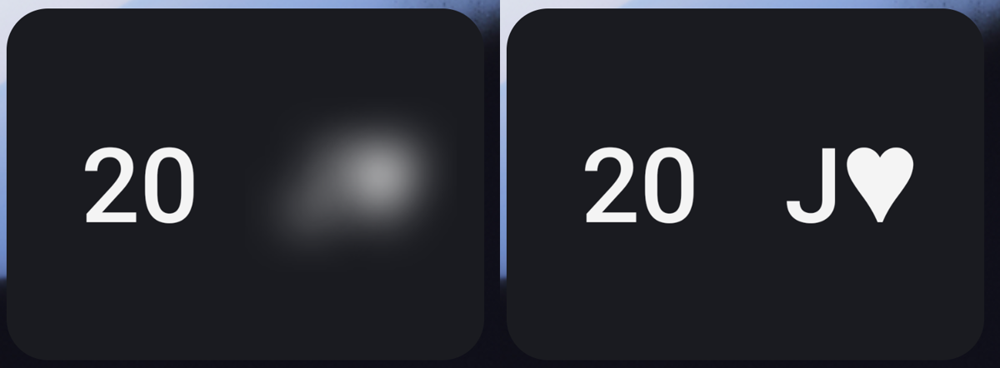

# Mnemonica widget

An Android lock screen widget for memorising Juan Tamariz's Mnemonica stack.

Each time you lock your phone, it deals a new position ↔ card pair. One side is blurred for 2.5 seconds, then sharpens over the next 2.5, giving you time to recall the answer. No interaction needed. Double tap the widget for a new pair.



## Install

1. Download the APK from [Releases](../../releases) and install it.
2. Open the app once.
3. Add the widget to your lock screen or home screen.

Needs Android 14 or later. Widgets on the phone lock screen need Android 16 QPR2 or later.

## How it works

- Widgets can't run their own animations. Each blur level sits in its own `ViewFlipper`, whose `inAnimation` starts on the first frame drawn, so the reveal plays when the widget comes into view.
- Widgets are never told when the phone locks. A small foreground service listens for the screen turning off and deals the next pair. Its notification stays in the Task Manager drawer, not the shade.
- Every position comes up once before the deck reshuffles.

## Build

```
./gradlew assembleDebug
```

Release builds are signed with the key described in `keystore.properties`, which is not in this repo. Without it, release builds fall back to the debug key.
